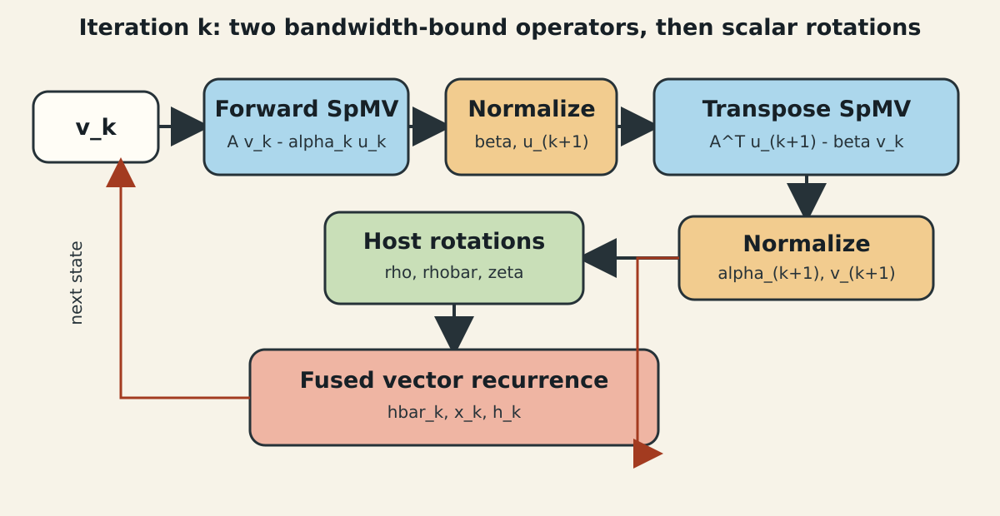
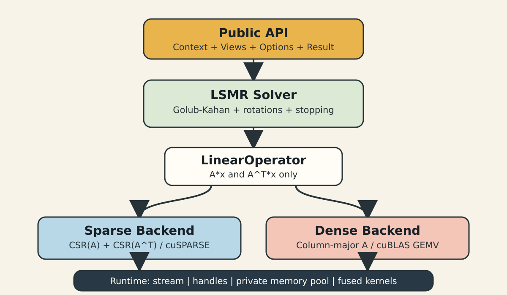

这组文章记录一个可调用 CUDA LSMR 库的完整实现。第一篇先不急着写 kernel，而是回答三个更根本的问题：LSMR 每轮到底搬了什么数据，哪些变化属于数值算法，哪些变化应该被隔离在矩阵后端，以及怎样让 CSC、CSR 和稠密矩阵共用同一套迭代逻辑。

## 1. 问题与性能指标

给定 $A\in\mathbb{R}^{m\times n}$ 和 $b\in\mathbb{R}^{m}$，LSMR 求解线性系统或最小二乘问题。带阻尼的形式是

$$
\min_x \left\|
\begin{bmatrix}
b\\0
\end{bmatrix}
-
\begin{bmatrix}
A\\\lambda I
\end{bmatrix}x
\right\|_2.
$$

它适合 $A$ 很大、很稀疏，无法显式形成 $A^TA$ 的场景。每轮主要工作不是复杂标量计算，而是

$$
A v_k,\qquad A^T u_{k+1},
$$

外加若干长度为 $m$ 或 $n$ 的向量更新与范数归约。若 CSR 的值和列索引都是 4 字节，仅顺序读取矩阵本体，一次 SpMV 至少要读取约 $8\operatorname{nnz}$ 字节；每轮前向、转置各一次，因此矩阵流量下界已经接近

$$
B_{\mathrm{matrix}}\ge 16\operatorname{nnz}\ \text{bytes/iteration}.
$$

这还没有计入 $x/y$ 向量、row offset 和缓存未命中。每个非零元素只贡献一次乘加，算术强度很低，LSMR 在大多数非结构稀疏矩阵上首先是显存带宽问题，而不是 FP32 峰值算力问题。

因此本文采用四类指标：迭代数和 stop code 检查算法轨迹；$\|Ax-b\|_2/\|b\|_2$ 检查结果；单次 solve wall time 衡量端到端迭代开销；矩阵格式与工作区字节数解释显存代价。

## 2. 数学定义与 FP32 语义

LSMR 基于 Golub-Kahan 双对角化。给定归一化后的 $u_k,v_k$，核心递推是

$$
\beta_{k+1}u_{k+1}=Av_k-\alpha_k u_k,
$$

$$
\alpha_{k+1}v_{k+1}=A^Tu_{k+1}-\beta_{k+1}v_k.
$$

随后通过一组稳定的对称 Givens 旋转更新 $\rho,\bar\rho,\zeta$，再更新搜索方向和解：

$$
\bar h_k=h_k-
\frac{\bar\theta_k\rho_k}{\rho_{k-1}\bar\rho_{k-1}}\bar h_{k-1},
$$

$$
x_k=x_{k-1}+\frac{\zeta_k}{\rho_k\bar\rho_k}\bar h_k.
$$



图 1：一轮 LSMR 的因果链。矩阵后端只负责两个蓝色 SpMV，旋转和停止条件不应知道 A 的存储格式。

库的矩阵、向量、SpMV 累加和输出均为 FP32。范数由 cuBLAS 以 FP32 输入计算，回到 host 后，旋转与停止规则用 double 标量计算，再把向量系数转换为 FP32。这样没有把整个迭代偷偷提升为 FP64，同时降低连续旋转中 host 标量舍入的影响。FP64 不是这组重建输入的默认路径，而且消费级 Ampere 的 FP64 吞吐代价也不适合被忽略。

## 3. 朴素实现为什么不够成为库

直接翻译论文或 CuPy 的 Python 循环，可以很快得到正确结果：每轮分别计算 `A @ v`、`A.T @ u`，再执行缩放、加法和范数。但它有三个工程问题。

第一，算法层直接持有具体稀疏类型时，CSC、CSR 和 dense 会产生分叉，停止规则容易被复制。第二，`u *= -alpha; u += A @ v` 会生成临时向量并多走几遍 global memory。第三，矩阵描述符、SpMV workspace 和迭代向量若跟着函数调用反复创建，分配和 Python 调度会进入热路径。

CuPy 的实现仍然是重要基线，因为它公开了清晰的 LSMR 递推和 SciPy 兼容语义；但“参考递推”与“复刻运行时组织”是两件事。库的目标是让数值流程保持可核验，同时把存储、调度和资源复用下沉。

## 4. 分层数据流



图 2：从稳定 API 到 CUDA backend 的单向依赖。上层只依赖能力，下层可以独立更换实现或 dispatch 策略。

这里借鉴 CUB 的思路，不是照搬它的 `Device/Dispatch/Agent` 类名，而是保留“接口、策略、执行机制分离”的关键性质：

- Public API 定义尺寸、精度、所有权和 host/device 位置。
- Solver 只看 `rows()`、`cols()`、$Ax$ 和 $A^Tx$。
- Operator 根据 sparse/dense 和方向选择 cuSPARSE 或 cuBLAS。
- Runtime 统一管理 stream、handle、显存池和 RAII buffer。
- Kernel 层只放无法由库调用合并的小向量递推。

OneFlow 的系统设计同样把 Operator、Kernel、DeviceCtx/stream 分开。这个边界对迭代求解器很实用：算法公式是 Operator 级语义，具体 CUDA 调用和异步执行属于 Kernel/runtime 语义。

## 5. 从接口到执行的逐层实现

### 5.1 用 LinearOperator 截断格式依赖

```cpp
class LinearOperator {
 public:
  virtual ~LinearOperator() = default;
  virtual std::int64_t rows() const noexcept = 0;
  virtual std::int64_t cols() const noexcept = 0;

  virtual void apply_scaled(float alpha, const float* x, float beta,
                            float* y) const = 0;
  virtual void apply_transpose_scaled(float alpha, const float* x, float beta,
                                      float* y) const = 0;
};
```

接口直接暴露 $y\leftarrow\alpha Ax+\beta y$，而不是只暴露 $y=Ax$。原因不是追求抽象完整，而是让 Golub-Kahan 分子

$$
Av_k-\alpha_k u_k
$$

可以直接映射成一次 cuSPARSE/cuBLAS 调用，避免先生成 `Av` 再单独读写 `u`。

### 5.2 PImpl 隔离 CUDA ABI 细节

公共头文件不包含 cuSPARSE descriptor 和内部 buffer。`Context`、`SparseMatrix`、`DenseMatrix`、`Solver` 都使用 PImpl。这样使用者看到的是稳定 C++17 接口，CUDA 12.9 的描述符字段、算法枚举和 workspace 查询留在 `.cu` 实现中。

### 5.3 Context 是资源边界

一个 Context 拥有一个 stream、一对绑定到该 stream 的 cuBLAS/cuSPARSE handle，以及一个私有 stream-ordered memory pool。矩阵和 Solver 引用它，但不各自创建 runtime。这也明确了并发规则：需要并行 stream 时创建多个 Context，而不是让多个 host 线程竞争同一组可变描述符。

## 6. shape、格式与 dispatch

当前 dispatch 有三条路径：CSC 输入构造双格式稀疏算子；CSR 输入构造同一种双格式算子；column-major dense 输入构造 cuBLAS 算子。Solver 不需要 `if (is_csc)`。

这与 OneFlow Softmax 文章中的 shape 分段思想一致：工业实现不应假定一个 kernel 对所有数据分布都最优。当前版本先按存储类别分派；后续如果加入按行长方差选择 CSR algorithm，或为极短行增加 warp 专用 kernel，也只修改 Operator 层。

代价同样明确：虚函数调用相对一次大 SpMV 可以忽略，但这套接口不适合在 device 内部逐元素调用；双格式存储还会接近翻倍占用矩阵显存。第二篇会单独量化这项交换。

## 7. 关键 CUDA 调用边界

稀疏后端缓存矩阵和 dense-vector descriptor，只在调用前替换输入输出指针：

```cpp
cusparseDnVecSetValues(input, const_cast<float*>(x));
cusparseDnVecSetValues(output, y);
cusparseSpMV(handle, CUSPARSE_OPERATION_NON_TRANSPOSE, &alpha,
             matrix, input, &beta, output, CUDA_R_32F,
             CUSPARSE_SPMV_CSR_ALG1, workspace);
```

描述符和 `workspace` 的创建不在迭代循环内。这里选择 `CUSPARSE_SPMV_CSR_ALG1` 是当前 CUDA 12.9/FP32 实测路径，而不是承诺所有 GPU 上都最优；cuSPARSE 文档也明确说明高性能算法不保证逐 bit 可复现。

## 8. 验证方法、局限与回退

框架阶段先用一个 $3\times2$ 矩阵验证 CSC、CSR、dense 三个后端的 $Ax$ 与 $A^Tx$ 完全一致，再用同一 Solver 测 dense b、sparse b 和多列 dense RHS。真实 benchmark 则固定 FP32、相同容差、相同最大迭代数，并同时比较 stop code、迭代数、解差与独立残差。

当前边界包括：仅实数 FP32 与 int32 索引；没有预条件器；多 RHS 是复用 workspace 后逐列求解，并非 block LSMR；当双格式超出显存预算时，应回退到单格式和 transpose SpMV，而不是冒险 OOM。

下一篇进入最关键的数据布局：为什么 CSC 输入仍要生成 CSR(A)，以及怎样让 $A^Tu$ 也变成顺序行遍历。

## 9. 参考资料

- [Fong 与 Saunders：LSMR 原始论文](https://arxiv.org/abs/1006.0758)
- [CuPy 14.0.0 LSMR 源码](https://github.com/cupy/cupy/blob/v14.0.0/cupyx/scipy/sparse/linalg/_solve.py)
- [NVIDIA cuSPARSE 12.9 文档](https://docs.nvidia.com/cuda/archive/12.9.2/cusparse/index.html)
- [dlog：CUB 归约的分层设计](https://dlog.com.cn/posts/cuda09/cub/)
- [OneFlow：系统设计（下）](https://www.oneflow.org/a/share/jishuboke/55.html)
- [OneFlow：高效 Softmax CUDA kernel](https://www.oneflow.org/a/share/jishuboke/54.html)

