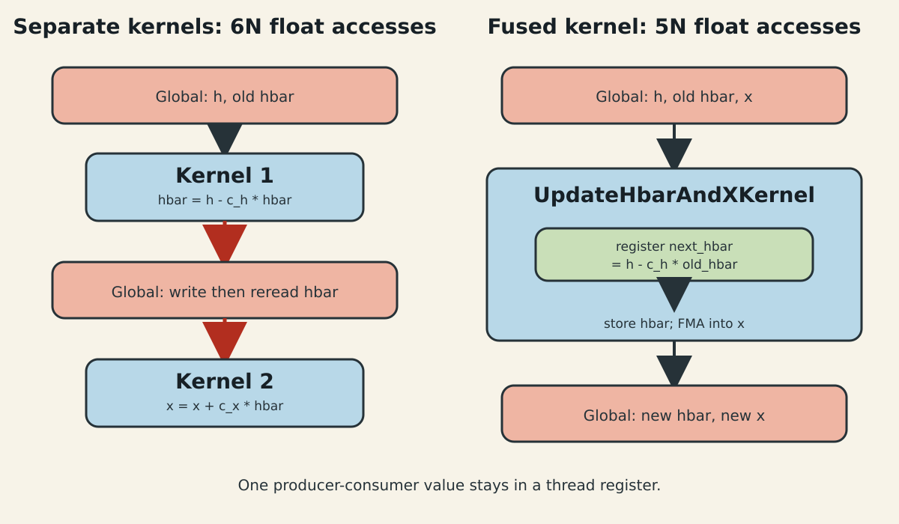
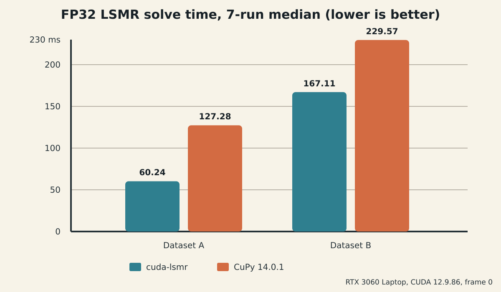

前两篇已经把 LSMR 的两个大头固定下来：Solver 不知道矩阵格式，SparseMatrix 则同时持有 CSR(A) 与 CSR($A^T$)。最后一篇处理 SpMV 之间的小向量递推，并给出两组真实重建输入的可复现结果。

这一步最容易犯的错误，是看到“自写 CUDA”就只比较时间。迭代求解器首先要对齐 stop code、迭代数和残差；只有数值轨迹成立，性能数字才有意义。

## 1. 剩余瓶颈与性能指标

每轮两次 SpMV 之间，LSMR 还要完成归一化、搜索方向和解更新。以长度 $n$ 的两条递推为例：

$$
\bar h\leftarrow h-c_h\bar h,
$$

$$
x\leftarrow x+c_x\bar h.
$$

分成两个 elementwise kernel 时，第一步读 `h/hbar`、写 `hbar`，第二步读 `x/hbar`、写 `x`，合计约 6 个长度 $n$ 的 FP32 流量，即 $24n$ 字节。融合后，每个元素读 `h/hbar/x`、写 `hbar/x`，约为 $20n$ 字节，同时少一次 kernel launch。

节省的 4 字节乘 $n$ 不是整个 LSMR 的主导项；真正价值是把确定存在的重复访问和 launch 去掉，同时保持公式边界清楚。评价仍以 solve wall time 为主，并记录迭代数、stop code、解相对差和独立计算的相对残差。

## 2. 递推与 FP32 误差语义

融合必须尊重依赖：$x_k$ 使用的是刚更新的 $\bar h_k$，不能把旧值读进另一个无序 kernel。逐元素形式为

$$
\bar h_{k,i}=h_{k,i}-c_h\bar h_{k-1,i},
$$

$$
x_{k,i}=x_{k-1,i}+c_x\bar h_{k,i}.
$$

两个式子对索引 $i$ 独立，因此可由同一个线程顺序完成。$h$ 的下一步更新

$$
h_{k+1,i}=v_{k+1,i}-c_v h_{k,i}
$$

与前两式没有需要跨线程同步的关系，但它读写另一组状态，保留为第二个 kernel 更简单。



图 1：融合前后不是改变数学，而是让同一线程在寄存器中转交新的 `hbar`。红色路径表示被消除的一次 global-memory 往返。

FP32 下不能要求不同归约树逐 bit 相同。这里采用三层正确性标准：stop code 与迭代数应一致；解相对差应落在 FP32 迭代可解释范围；最终使用同一个 CuPy sparse matrix 重新计算 $\|Ax-b\|_2/\|b\|_2$，两者应匹配。

## 3. 未融合实现的成本

CuPy 版本把递推写成清晰的数组表达式，适合作为算法参考，但每个表达式由 Python 驱动：

```python
hbar *= -coefficient
hbar += h
x += step * hbar
h *= -theta_over_rho
h += v
```

memory pool 可以复用分配，却不会自动把这些语句融合成一个 CUDA kernel；矩阵乘法返回临时向量后，后续加法也会增加一次遍历。对于 Dataset A/B 这类每轮 SpMV 已很快、迭代约百次的输入，host 调度和小 kernel 数量不是零成本。

纯 CUDA 库有两个可控点：矩阵递推通过 cuSPARSE 的 `beta` 参数原位完成；依赖明确的小向量递推手写融合。范数仍交给 cuBLAS，不重复实现工业归约。

## 4. 融合数据流

从一轮的数据路径看，融合后的顺序是：

$$
u\xleftarrow{\mathrm{CSR}(A)}v
\rightarrow \|u\|_2
\rightarrow
v\xleftarrow{\mathrm{CSR}(A^T)}u
\rightarrow \|v\|_2
\rightarrow
(\bar h,x,h).
$$

两个 norm 会把 FP32 标量送回 host，因为停止条件需要分支；其余状态保持在设备端。LSMR 的每一轮天然依赖上一轮，不能简单把多轮并发。优化重点应放在一轮内部的数据复用，而不是制造错误的跨轮流水。

对右端项也采用一次性适配：dense b 若在 host 则复制到复用 buffer；sparse b 先 `memset`，再按唯一索引 scatter 成 dense u。LSMR 后续所有递推统一处理 dense 向量，不在热循环里保留 sparse-b 分支。

## 5. Kernel 实现与适用条件

核心 kernel 很短：

```cpp
__global__ void UpdateHbarAndXKernel(
    float* hbar, const float* h, float* x,
    float coefficient, float step, std::int64_t size) {
  const std::int64_t i =
      static_cast<std::int64_t>(blockIdx.x) * blockDim.x + threadIdx.x;
  if (i < size) {
    const float next_hbar = h[i] - coefficient * hbar[i];
    hbar[i] = next_hbar;
    x[i] = fmaf(step, next_hbar, x[i]);
  }
}
```

每个线程只处理一个连续元素，256 threads/block。这里没有 shared memory、warp shuffle 或复杂 occupancy tuning，因为算子是纯带宽型逐元素更新，寄存器状态只有少量 float；引入 shared memory 只会增加搬运。

融合适用于两式存在逐元素生产者-消费者关系、shape 相同、没有跨元素归约的场景。代价是降低单个基础算子的复用性，所以它放在 LSMR 私有 kernel 层，不暴露成通用 public API。

OneFlow Softmax 的优化也从“naive 多次 global memory”出发，用融合和寄存器缓存减少数据往返；共同原则是先列出实际访存，再决定融合，而不是看到多个 kernel 就机械合并。

## 6. shape、对齐与 dispatch

本 kernel 对任意 $n$ 使用尾部判断，不要求 16-byte 对齐。`float4` 能减少指令数，但 `hbar/h/x` 三个输入输出指针需要共同对齐，尾部还要单独处理；在当前 $n=6177$ 和 $23394$ 上，SpMV 占比更大，先保留简单标量路径。

矩阵方向的 dispatch 则更重要：sparse A 走双 CSR SpMV，dense A 走 GEMV；sparse b 只在入口 scatter；多 RHS 当前逐列求解。没有把 SpMV 与 SpMM 混为一谈，也没有声称一个融合 kernel 适合所有 shape。

如果未来 profile 显示向量 kernel 成为主导，可以按对齐和 $n$ 分派 `float4` 路径；如果多个 RHS 改为 block LSMR，则应重新设计 B/C tile 复用，而不是继续逐列调用。

## 7. 可调用接口与 benchmark 脚本

C++ 调用者提供 device 输出，Context 复用所有工作区：

```cpp
cuda_lsmr::Context context;
auto A = cuda_lsmr::SparseMatrix::FromCsc(context, csc_view);
cuda_lsmr::Solver solver(context);

cuda_lsmr::SolverOptions options;
options.atol = 1.0e-6F;
options.btol = 1.0e-6F;
options.max_iterations = 5000;

auto result = solver.solve(*A, dense_b, device_x, options);
context.synchronize();
```

用于对比的 pybind11 层不参与算法，只接收 CuPy 的 `b.data.ptr` 与 `x.data.ptr`。矩阵加载、SciPy 转 CSC、H2D、双格式构造和两轮 warmup 都在计时外。CuPy 显式传入 FP32 零 `x0`，避免其兼容路径把迭代解向量提升精度。

## 8. Dataset A/B 结果、容差与局限

测试环境为 RTX 3060 Laptop 6 GiB、CUDA 12.9.86、driver 581.57、CuPy 14.0.1。参数固定为 `damp=0`、`atol=btol=1e-6`、`conlim=1e8`、`maxiter=5000`。每组执行 7 次同步 solve，报告中位数。

| 数据集 | shape | nnz | CUDA LSMR | CuPy | 时间比 | 迭代数 |
| --- | ---: | ---: | ---: | ---: | ---: | ---: |
| Dataset A | $306136\times6177$ | 5,588,894 | 60.24 ms | 127.28 ms | 0.473 | 86 / 86 |
| Dataset B | $936063\times23394$ | 19,747,202 | 167.11 ms | 229.57 ms | 0.728 | 96 / 96 |



图 2：同一 GPU、同一输入和停止参数下的 7 次中位数。数字只代表这两组矩阵，不用于宣称普遍快于 CuPy/cuSPARSE。

两边 stop code 均为 2，即近似满足最小二乘停止条件。解相对差为 $1.84\times10^{-7}$ 和 $6.26\times10^{-7}$。独立重算的相对残差分别为 0.3540266 和 0.2360898，两种实现一致。残差不接近零并非失败：输入是非一致最小二乘系统，应该比较停止语义与残差是否对齐。

性能达到并超过“与 CuPy 基本持平”的目标，但边界必须保留：双格式占用更多 VRAM；当前仅 FP32/int32；无预条件器；消费级 GPU 上的结果不能外推到 A100/H100；不同 CSR 行长分布可能改变 cuSPARSE 占比。若显存不足，回退单格式；若要求逐 bit 确定性，应选择对应 cuSPARSE algorithm 并接受吞吐代价。

## 9. 参考资料

- [Fong 与 Saunders：LSMR 原始论文](https://arxiv.org/abs/1006.0758)
- [CuPy 14.0.0 LSMR 源码](https://github.com/cupy/cupy/blob/v14.0.0/cupyx/scipy/sparse/linalg/_solve.py)
- [NVIDIA cuSPARSE 12.9 文档](https://docs.nvidia.com/cuda/archive/12.9.2/cusparse/index.html)
- [OneFlow：高效 Softmax CUDA kernel](https://www.oneflow.org/a/share/jishuboke/54.html)
- [OneFlow：系统设计（下）](https://www.oneflow.org/a/share/jishuboke/55.html)
- [CUDA Programming Guide：显式 memory pool](https://docs.nvidia.com/cuda/cuda-programming-guide/04-special-topics/stream-ordered-memory-allocation.html)
