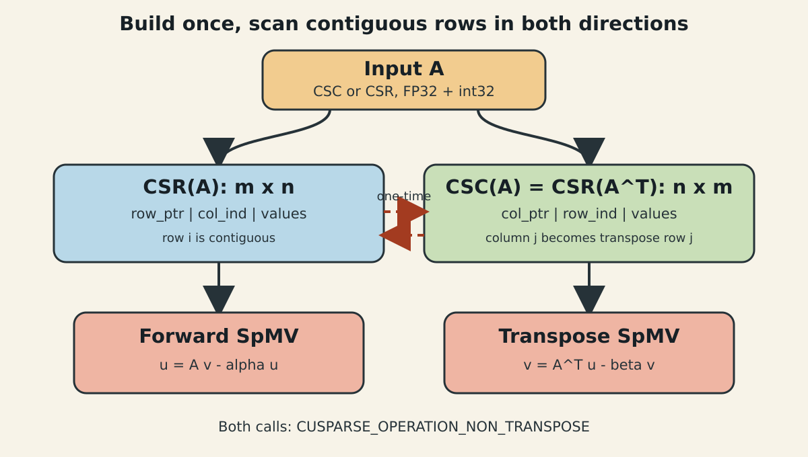
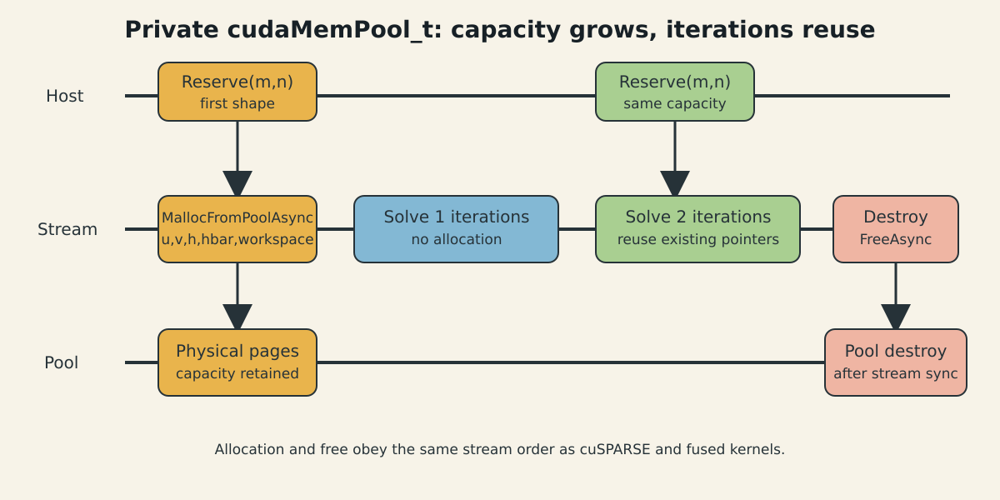

上一篇把 LSMR 拆成 Solver 与 LinearOperator。这一篇只盯住 Operator 中最贵的两步：$Av$ 和 $A^Tu$。核心结论很直接：既然每轮都要沿两个方向扫完整个稀疏矩阵，就分别为两个方向准备连续的“行”，而不是让一个格式勉强承担所有访问。

## 1. 为什么双向 SpMV 是瓶颈

对 $A\in\mathbb{R}^{m\times n}$，LSMR 每轮各执行一次

$$
y_m=Av_n,\qquad z_n=A^Tu_m.
$$

设每个非零值和索引各 4 字节。忽略向量缓存和 offset，一次方向的矩阵读取至少为

$$
B_{\mathrm{SpMV}}\ge (4+4)\operatorname{nnz}=8\operatorname{nnz}\ \text{bytes}.
$$

对应计算量约为 $2\operatorname{nnz}$ FLOP，理想算术强度不超过

$$
I\le \frac{2\operatorname{nnz}}{8\operatorname{nnz}}=0.25\ \text{FLOP/byte},
$$

实际还会更低。于是 roofline 上界首先由显存带宽决定。优化目标不是让每个线程多做几个 FMA，而是让 warp 读取连续的 values/indices、减少无效流量，并避免转置路径产生更差的归约或 scatter 行为。

## 2. CSR、CSC 与精度语义

CSR(A) 由三个数组组成：

- `row_ptr` 长度为 $m+1$，第 $i$ 行区间是 `[row_ptr[i], row_ptr[i+1])`；
- `col_ind[p]` 给出第 $p$ 个非零元素的列；
- `values[p]` 给出其 FP32 数值。

因此

$$
(Av)_i=\sum_{p=\mathrm{row\_ptr}_i}^{\mathrm{row\_ptr}_{i+1}-1}
\mathrm{values}_p\,v_{\mathrm{col\_ind}_p}.
$$

CSC(A) 则用 `col_ptr` 压缩列，`row_ind` 保存行号。关键观察是：CSC(A) 的内存结构恰好就是 CSR($A^T$)。如果把 descriptor 的尺寸设为 $n\times m$，就能直接计算

$$
z=A^Tu
$$

而不向 cuSPARSE 请求 transpose 操作。

矩阵值、输入、输出和 SpMV compute type 都固定为 FP32。这里没有 half2 或 Tensor Core 路径，因为不规则 SpMV 的主要矛盾是索引与带宽，而且测试输入已经是 FP32；盲目把值降到 FP16 会改变最小二乘系统的条件与停止轨迹。

## 3. 单格式实现的瓶颈

如果只保留 CSC(A)，$A^Tu$ 很自然，但 $Av$ 的行归约不再连续；只保留 CSR(A) 则相反。cuSPARSE 支持格式和 transpose 枚举，但官方文档明确指出 transpose 操作没有结果复现保证，而且具体算法的数据路径由库内部决定。

更重要的是，LSMR 不是偶尔做一次转置乘法，而是每轮固定交替两个方向。一次性多存一份矩阵，与每轮承担方向不匹配的代价，属于典型的“空间换稳定热路径”。

朴素的另一项问题是运行时转换：若在每次 `A.T @ u` 前生成转置格式，转换成本会直接乘以迭代数。正确边界是在 SparseMatrix 构造时完成一次转换，并让两个 descriptor 随矩阵生命周期存在。

## 4. 双格式数据流



图 1：输入无论是 CSC 还是 CSR，构造阶段都补齐另一种格式。求解阶段的两个方向均使用 `NON_TRANSPOSE` CSR SpMV。

CSR 到 CSC 使用 `cusparseCsr2cscEx2`。CSC 输入可以直接解释成 CSR($A^T$)，再把 $A^T$ 从 CSR 转成 CSC；所得 CSC($A^T$) 的数组，正好就是 CSR(A)。这个变换只重排一次 values/indices。

双存储的字节代价可近似写成

$$
M_{\mathrm{dual}}\approx
2\left[8\operatorname{nnz}+4(m+n+2)\right].
$$

Dataset B 的 $\operatorname{nnz}=19{,}747{,}202$，仅双份 values/indices 已约为 301 MiB；还要为 offset、cuSPARSE workspace、LSMR 向量和内存池物理页留余量。这是明确的成本，不应只谈速度不谈容量。

## 5. 从基础到工业实现

### 5.1 构造时转换，迭代时只换指针

```cpp
cusparseCsr2cscEx2(
    handle, rows, cols, nnz,
    csr_values, csr_offsets, csr_indices,
    csc_values, csc_offsets, csc_indices,
    CUDA_R_32F, CUSPARSE_ACTION_NUMERIC,
    CUSPARSE_INDEX_BASE_ZERO, CUSPARSE_CSR2CSC_ALG1,
    conversion_workspace);
```

构造完成后创建两个 sparse descriptor、四个 dense-vector descriptor，并查询两个方向所需 workspace 的最大值。热路径只调用 `cusparseDnVecSetValues` 替换指针，然后发射 SpMV。

### 5.2 用 beta 项吃掉 Golub-Kahan 旧向量

前向递推的分子是

$$
u\leftarrow Av-\alpha u.
$$

直接设 `alpha=1`、`beta=-alpha_k`，让 cuSPARSE 在输出 `u` 上完成它，避免生成 `Av` 临时向量和一次额外 elementwise kernel。转置方向同理：

$$
v\leftarrow A^Tu-\beta v.
$$

### 5.3 行长分布决定负载不均

CSR 的“连续”不等于“均衡”。若某些行只有几个非零，而另一些行有上万个非零，固定的一行一 warp 会让不同 warp 的工作量严重失衡；短行还会浪费 lane，长行则需要循环和跨 warp 归约。

本项目把通用不规则矩阵交给 `CUSPARSE_SPMV_CSR_ALG1`，没有虚构一个自写 kernel 普遍胜过 cuSPARSE。未来可在 Operator dispatch 中统计

$$
\ell_i=\mathrm{row\_ptr}_{i+1}-\mathrm{row\_ptr}_i
$$

的均值、方差和长尾，再为窄分布短行选择专用 warp kernel。机制、适用条件和维护代价必须一起评估。

## 6. SpMV、SpMM 与 shape dispatch

这里必须区分 SpMV 和 SpMM。单个 LSMR 右端项的 $v,u$ 都是向量，核心操作是 SpMV。`solve_many` 虽然接受 dense RHS 矩阵，但每一列有自己的 $\alpha_k,\beta_k$、旋转和停止时刻，当前实现是逐列运行独立 LSMR，并不把它伪装成 SpMM。

真正的 block LSMR 才会让 B/C tile 在多个右端项之间复用：CSR(A) 的 values/indices 读一次，与 $V\in\mathbb{R}^{n\times r}$ 的一小块相乘，形成 $U\in\mathbb{R}^{m\times r}$。当 $r$ 足够大时，B tile 的连续列和输出 C tile 提高算术强度；代价是块正交化、更复杂的收敛判断和更大的寄存器/显存工作区。

当前 dispatch 因此保持诚实：`r=1` 走 SpMV；多列输入复用内存但逐列求解；未来只有实现块算法后才启用 SpMM。

## 7. 显存池与代码边界

矩阵双存储解决稳定带宽，显存池解决稳定延迟。Context 创建私有 `cudaMemPool_t`，所有内部 buffer 都走显式 pool：

```cpp
cudaMallocFromPoolAsync(
    reinterpret_cast<void**>(&data), bytes, pool, stream);

// Destruction remains ordered behind prior work on the same stream.
cudaFreeAsync(data, stream);
```



图 2：第一次 shape 扩容向 pool 请求物理页，后续 solve 复用容量；free 也按 stream 排序，不引入 `cudaFree` 的全局同步语义。

这与 CuPy 默认 memory pool 的目标相同，但库使用私有 pool，避免修改进程全局默认池。`DeviceBuffer::Resize` 仅在新 shape 超过 capacity 时重新申请；迭代循环内没有分配。

## 8. 验证、边界与回退

双路径测试使用同一个小矩阵，分别从 CSR 和 CSC 构造，比较两个方向与 dense GEMV 的结果。Compute Sanitizer 对 Solver 测试报告 0 个访问错误。真实数据则记录 pool reserved bytes：Dataset A 约 192 MiB，Dataset B 约 640 MiB；这是 pool 的物理页保留量，不等于矩阵数组的精确逻辑字节数。

双存储适用于矩阵复用多个迭代、显存充足、两个方向频率相近的场景。如果矩阵只乘一次、转置极少使用，或双份数据会逼近 OOM，应回退为单格式。若索引或 $\operatorname{nnz}$ 超过 int32 范围，当前 API 会拒绝输入，而不是截断。

下一篇会进入剩余热路径：怎样融合 $\bar h/x/h$ 递推，以及为什么最终 Dataset A/B 的迭代轨迹能与 CuPy 对齐。

## 9. 参考资料

- [NVIDIA cuSPARSE 12.9：CSR/CSC 与 SpMV](https://docs.nvidia.com/cuda/archive/12.9.2/cusparse/index.html)
- [CUDA Programming Guide：Stream-Ordered Memory Allocator](https://docs.nvidia.com/cuda/cuda-programming-guide/04-special-topics/stream-ordered-memory-allocation.html)
- [NVIDIA：Using the Stream-Ordered Memory Allocator](https://developer.nvidia.com/blog/using-cuda-stream-ordered-memory-allocator-part-1/)
- [OneFlow：高效 Softmax CUDA kernel 的带宽分析与 shape 分段](https://www.oneflow.org/a/share/jishuboke/54.html)
- [dlog：CUB 归约的分层设计](https://dlog.com.cn/posts/cuda09/cub/)
